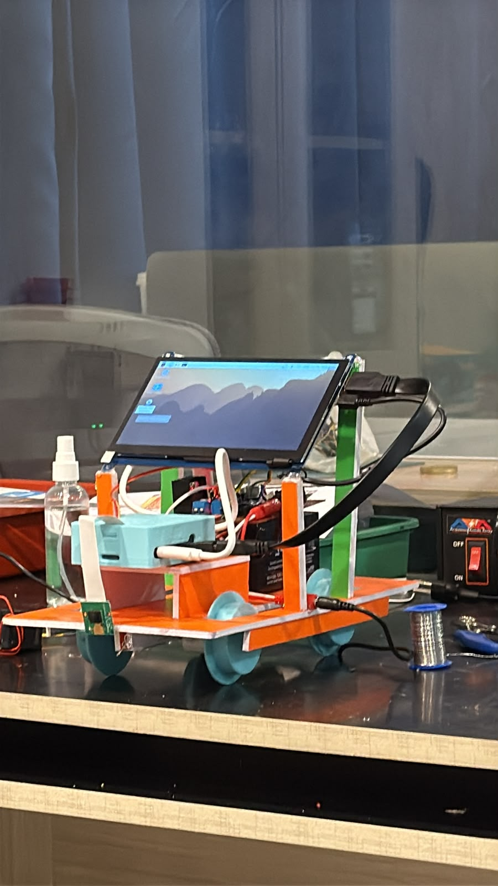

# Railway Track Defect Detector

A research prototype that trains a YOLOv8n object detector in Google Colab and runs it locally on a Raspberry Pi 4 Model B with a Raspberry Pi Camera Module 1.3. The Pi dashboard displays an annotated camera feed and saves defect snapshots locally.

> **Prototype status:** This project is for learning and demonstration. It is not certified railway inspection equipment. Do not use detections to control a moving robot or make safety decisions without independent validation and appropriate engineering safeguards.

## What is included

- Google Colab notebook for training and NCNN export.
- Raspberry Pi live camera detector, local dashboard, and desktop launcher.
- The current trained model package in `models/railway_pi_deployment.zip`.
- Raspberry Pi case and wheel CAD files in `hardware/`.
- Project review slides, validation plots, and metric exports in `docs/project-review/`.
- Photos and a short video of the assembled prototype in `docs/prototype-media/`.
- Contribution, security, and community guidelines.

The repository does not include the dataset ZIP or extracted images. The dataset export exceeds GitHub's per-file upload limit and should be downloaded from its [Roboflow project](https://universe.roboflow.com/csci-199/rsdd-split-4) when training. The export identifies its dataset license as **CC BY 4.0**. Keep the required attribution when redistributing the dataset or results derived from it.

## Prototype media

The following media show the assembled Raspberry Pi railway inspection prototype.



[Watch the prototype video](docs/prototype-media/railway-detector-prototype.mp4)

## Model and dataset

The model detects two classes: `defective` and `non-defective`. The included training configuration used YOLOv8n, 640 × 640 input, batch size 16, and 100 epochs. The dataset split contains 1,198 training, 101 validation, and 54 test images.

The saved validation row with the highest mAP50–95 is epoch 86:

| Validation measure | Result |
| --- | ---: |
| Precision | 92.0% |
| Recall | 89.4% |
| mAP50 | 92.7% |
| mAP50–95 | 62.7% |

These are validation scores, not held-out test scores. The Colab notebook includes a separate test evaluation step, but the supplied deployment archive does not include its test-evaluation output. Raspberry Pi timing in the review files comes from one still-image run and is not a sustained video benchmark.

## Train in Google Colab

1. Open `training/train_yolov8_railway_defects_colab.ipynb` in Google Colab.
2. Choose **Runtime → Change runtime type → T4 GPU** (or another CUDA GPU).
3. Download the Roboflow YOLOv8 dataset export and upload its ZIP in the notebook, or use the Google Drive option in the notebook.
4. Run the notebook from top to bottom. It trains YOLOv8n, evaluates the test split, exports NCNN, and packages the model artifacts.
5. Download the resulting `railway_pi_deployment.zip` and keep a backup of it.

The notebook expects a GPU. If Colab reports that CUDA is unavailable, change the runtime to a GPU and reconnect before running the training cell.

## Deploy to Raspberry Pi

The instructions below assume Raspberry Pi OS 64-bit, a Pi 4, and a working Camera Module 1.3. Confirm camera access with `rpicam-hello` first.

```bash
sudo apt update
sudo apt install -y python3-venv python3-picamera2 python3-opencv
```

Clone this repository on the Pi, prepare the app directory, and unpack the included model:

```bash
git clone https://github.com/naga-ch/railway-track-defect-detector.git
mkdir -p ~/railway_detector
cp -a railway-track-defect-detector/pi/. ~/railway_detector/
unzip -o railway-track-defect-detector/models/railway_pi_deployment.zip -d ~/railway_detector
python3 -m venv --system-site-packages ~/railway-venv
source ~/railway-venv/bin/activate
pip install -r railway-track-defect-detector/requirements-pi.txt
```

The virtual environment uses Raspberry Pi OS's Picamera2 and OpenCV packages through `--system-site-packages`.

Start the dashboard from a Pi terminal:

```bash
source ~/railway-venv/bin/activate
python ~/railway_detector/railway_dashboard.py
```

To add the desktop shortcut:

```bash
chmod +x ~/railway_detector/start_railway_dashboard.sh ~/railway_detector/install_railway_desktop_icon.sh
bash ~/railway_detector/install_railway_desktop_icon.sh
```

The launcher opens a local dashboard on the Pi. It binds to `127.0.0.1` by default. Keep that setting unless you understand the security impact of exposing the camera dashboard to a network.

For terminal-only operation:

```bash
source ~/railway-venv/bin/activate
python ~/railway_detector/live_camera_detector.py --headless
```

See [`docs/COLAB_PI_GUIDE.md`](docs/COLAB_PI_GUIDE.md) for the longer setup notes and touchscreen workflow.

## Repository layout

```text
pi/                       Pi camera detector, dashboard, and launch scripts
training/                 Colab training notebook
models/                   Trained model and NCNN deployment archive
hardware/                 Pi enclosure and wheel CAD files
docs/project-review/      Slides, metrics, and validation diagnostics
.github/                  Issue and pull request templates
```

## License and reuse

No software license has been selected for this repository. Until the project owner adds one, GitHub's default copyright applies to the code and CAD files. The dataset has its own CC BY 4.0 terms and attribution requirements; those terms do not automatically license this repository's software or model artifacts. See [`docs/project-review/README.txt`](docs/project-review/README.txt) for the included results files.
